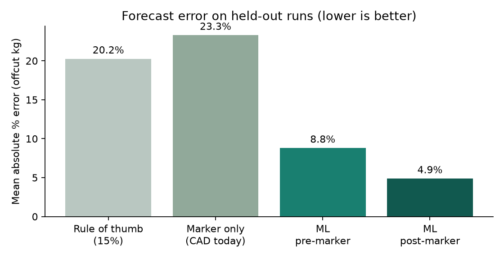
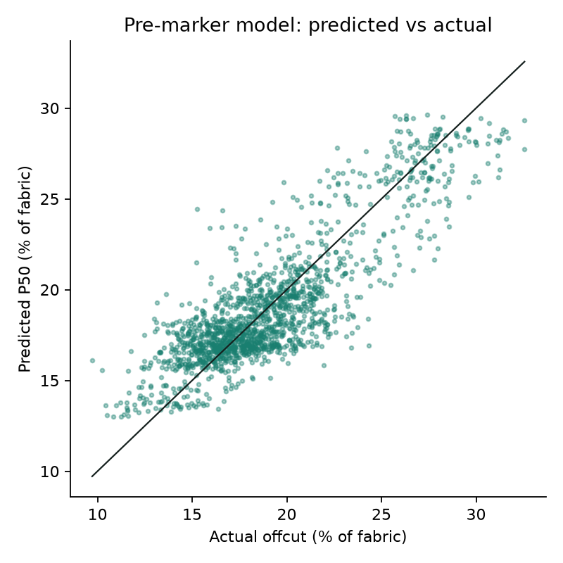

# 2. Machine learning models

The two trained models in the repo: the offcut forecast (Part 01, earlier exploratory work for a previous idea, garment factories, not the product) and the stall-risk model (Part 04).

Thread Futures is a B2B resale service for fashion brands: we act as their sales team for stock they can't sell themselves, and give them the money from each sale plus a report of where every item went. The code described here is earlier, exploratory technical work, not the product. Nothing new is built during customer discovery (to early 2027), and any early pilot runs by hand (spreadsheet and email). See [ARCHITECTURE.md](ARCHITECTURE.md) for how the parts fit together.

Each part starts with a header block (discipline, methodology, tools, status), then the short part note, then the full step-by-step guide.

## Contents

- [Part 01: Offcut forecasting](#part-01-offcut-forecasting)
  - [Part 01 step by step](#part-01-step-by-step)
- [Part 04: Stall-risk model](#part-04-stall-risk-model)
  - [Part 04 step by step](#part-04-step-by-step)

---

## Part 01: Offcut forecasting

**Discipline:** Machine Learning / Data Science (primary / secondary)  
**Methodology:** `src/offcut/simulate.py` and `nesting.py` simulate 8,000 cutting runs: graded pattern pieces are packed into a marker by a skyline heuristic, then real-world losses are added. `train.py` fits three scikit-learn `GradientBoostingRegressor` models with quantile loss (P10, P50, P90) on order fields only and compares them with a marker-only and a flat-15% baseline; `export.py` writes the trees to JSON so `site/forecast.js` can evaluate them in the browser.  
**Tools:** Python, scikit-learn, pandas, NumPy, Matplotlib, JavaScript  
**Status:** Parked: earlier exploratory work for a previous idea (garment factories), not the product.

**Build state:** Built, parked. Earlier exploratory work for a previous idea (garment factories), not the product · **Data label:** Simulated data  

### In one line
Forecasts how many kilograms of fabric offcuts a planned cutting run will produce, as a low, likely and high range, before any fabric is cut.

### Why it matters
Cutting plans (markers) report planned efficiency, but cutting rooms lose more fabric than the plan shows: selvedge trim, ply ends, roll remnants, splices, defects. Knowing the likely weight early lets a factory plan a buyer for the offcuts. This was an earlier idea. Thread Futures now focuses on finished clothes and shoes that brands can't sell, so this part is kept as proof of build: it shows a full forecasting pipeline, built and tested from start to finish by one person.

### Data
8,000 simulated production runs from a simulator that nests graded pattern pieces into markers and adds real-world losses. Calibrated to published industry ranges (simulated waste averages about 19% of fabric, inside the 10 to 20% range). Not factory data.

### Method
Gradient-boosted quantile regression (P10, P50, P90) on order data only. Compared with two real baselines: the marker alone and a flat 15% rule of thumb. Interval coverage checked. Trees exported to JSON and evaluated in plain JavaScript in the browser.

### Tools
Python, scikit-learn (GradientBoostingRegressor, quantile loss), pandas, NumPy, Matplotlib, JavaScript

### Result
On 1,600 held-out simulated runs: 8.8% mean error on offcut kg vs 20.3% for the 15% rule and 23.3% for the marker alone; 82.4% of runs within ±15%; P10 to P90 range covers 76.8% of outcomes (target 80%). With the planned marker as an input: 4.9% error. A float32 split-threshold bug in the browser export was found and fixed: scikit-learn compares inputs as 32-bit floats, and rounded thresholds made edge inputs (e.g. a 1.57 m roll) take a different branch. A test now proves the export matches scikit-learn.





Both figures are written by `src/offcut/train.py` from the held-out simulated runs.

### Honest limits
Trained on simulated runs; no factory has used it. If the idea were picked up again, the first goal would be ±15% on real weighed output. Coverage is slightly under the 80% target.

### Where it lives
src/offcut/ (simulate.py, nesting.py, train.py, export.py), site/forecast.js, models/metrics.json

### Part 01 step by step

**Build state:** Built, parked. Earlier exploratory work for a previous idea (garment factories), not the product; kept as proof of build · **Data label:** SIMULATED cutting runs (not factory data)
**Code:** `src/offcut/` (simulate.py, garments.py, nesting.py, pipeline.py, train.py, export.py), `site/forecast.js`
**Numbers from:** `models/metrics.json`, `data/staged/quality_report.json`

---

#### 1. The question this stage answers

Before a factory cuts a production run, how many kilograms of fabric offcuts will it end up weighing, as a low, likely and high range?

A fashion brand cares because offcuts are fabric it has already paid for. If the factory knows the likely weight and fibre before cutting, it can line up a recycler and sell the offcuts as a planned lot instead of sweeping them into a skip. The cutting plan software (the marker) reports a planned waste figure, but real cutting rooms lose more than that, so planning on the marker figure leaves you short every time.

---

#### 2. The pipeline, step by step

##### Step 1. Describe the garments as pattern pieces

**What happens:** each of five garments (tee, hoodie, shirt, jeans, dress) is written down as a list of pattern pieces at size M: width across the fabric, length along it, how much of its bounding box the real piece fills, and how many are cut per garment.

**Where:** `src/offcut/garments.py`, `GARMENTS`, `SIZE_SCALE`, `SIZE_MIXES`, `graded_pieces()`

**In:** hand-written piece dimensions. **Out:** a library of garments that can be scaled to any size.

```python
SIZE_SCALE = {"XS": 0.92, "S": 0.96, "M": 1.00, "L": 1.04, "XL": 1.08, "XXL": 1.12}

SIZE_MIXES: Dict[str, Dict[str, int]] = {
    "narrow":   {"S": 1, "M": 2, "L": 2, "XL": 1},
    "standard": {"XS": 1, "S": 2, "M": 3, "L": 3, "XL": 2, "XXL": 1},
    "extended": {"XS": 1, "S": 1, "M": 2, "L": 2, "XL": 2, "XXL": 2},
}
```

- `SIZE_SCALE`: linear grading. An XL piece is 8% bigger in each direction than an M piece.
- `SIZE_MIXES`: how many garments of each size are cut together in one marker. "standard" cuts 12 garments per marker, peaked at M and L.

**Why this way:** there is no public dataset of factory cutting runs. Building from first principles means every number in the simulation has a physical meaning I can explain.

##### Step 2. Build a marker (the cutting plan) for each run

**What happens:** the pieces for one size mix are packed onto the fabric width with a "skyline bottom-left" packing heuristic. Several orderings are tried and the shortest marker is kept, as a marker maker would.

**Where:** `src/offcut/nesting.py`, `build_marker()`, `_skyline_pack()`, `_orderings()`

**In:** a garment, usable fabric width, size mix. **Out:** a `Marker` with length, true piece area and efficiency.

```python
length = min(_skyline_pack(order, width_cm) for order in _orderings(rects, seed))
# The calibration factor can occasionally overshoot what any real marker achieves;
# hold efficiency at the published upper bound for cut-and-sew garments.
length = max(length, true_area / (width_cm * MAX_EFFICIENCY))
return Marker(width_cm, length, true_area, len(rects), n_garments)
```

- Line 1: pack the pieces in each candidate order and keep the shortest marker.
- Line 4: never let efficiency go above 93% (`MAX_EFFICIENCY = 0.93`), the top of published ranges.
- Line 5: return the marker. Efficiency = true piece area / (width x length).

**Why this way:** real nesting software handles irregular shapes. I approximate each piece by a rectangle of equal area, adjusted by a per-garment calibration factor `nest_k`, so simulated efficiencies land in published ranges. Pieces are never rotated 90 degrees, because grain direction matters in real cutting.

##### Step 3. Simulate the real-world losses the marker does not see

**What happens:** for each of 8,000 runs, the simulator picks garment, fibre, size mix, width, fabric weight (gsm) and fabric length, then adds the losses that happen on the cutting-room floor.

**Where:** `src/offcut/simulate.py`, `simulate_run()`, `simulate()`

**In:** random but seeded choices. **Out:** one row per run, including the weighed offcut kg.

```python
ply_len = (m_len + 2 * end_allow / 100) * (1 + spread)
roll_m = rng.uniform(20, 30) * 1000 / (gsm * width) if g.knit else rng.uniform(60, 120)
plies_per_roll = int(roll_m // ply_len)
...
remnant_m = n_rolls * (roll_m - plies_per_roll * ply_len)
...
weighed = offcut_true * recovery * (1 + rng.gauss(0, 0.01))
```

- `ply_len`: each layer of fabric is laid a little longer than the marker at each end (end allowance), plus spreading loss (tension, slippage, splices).
- `roll_m`: knit rolls are sold by weight (20 to 30 kg), so heavier or wider knit means a shorter roll; woven rolls are 60 to 120 m.
- `plies_per_roll`: a roll rarely divides into whole plies.
- `remnant_m`: the leftover at the end of each roll. Part is reused, the rest is waste.
- `weighed`: some lint and sweepings are never weighed (`recovery`), plus 1% weighing noise.

Selvedge trim (1 to 2 cm per edge on wovens) and defects are also simulated. Everything is seeded (`seed=11`), so the same 8,000 runs come out every time.

**Why this way:** this is exactly the gap between the marker and reality that a model has to learn. A test (`tests/test_offcut.py::test_mass_balance_and_gap`) checks that real waste always exceeds what the marker alone predicts.

##### Step 4. Land, check and split the data (bronze, silver, gold)

**What happens:** raw runs are written to CSV (bronze), checked against a data contract and written to a staged CSV with a quality report (silver), then tagged train or test (gold).

**Where:** `src/offcut/pipeline.py`, `extract()`, `validate()`, `stage()`, `features()`

```python
CONTRACT: Dict[str, Tuple[str, float, float]] = {
    "fabric_width_m": ("float", 1.2, 2.2),
    "gsm": ("float", 60, 500),
    "fabric_metres": ("float", 500, 60_000),
    "marker_efficiency": ("float", 0.6, 0.95),
    "input_kg": ("float", 1, None),
    "offcut_kg_weighed": ("float", 0, None),
    "offcut_ratio": ("float", 0.05, 0.6),
}
```

- Each line says: this column must exist, have no nulls, and sit inside this range.
- `validate()` also checks categories are known, `run_id` is unique, and mass balance holds (offcut can't weigh more than the fabric that went in).
- `stage()` writes `quality_report.json` and raises an error if anything fails, so bad data never reaches training.

The split:

```python
is_test = df["run_id"].apply(lambda s: int(s.split("-")[1]) % 5 == 0)
```

Every fifth run (run number divisible by 5) goes to test. That gives 6,400 train and 1,600 test.

**Why this way:** the split is deterministic, so results are reproducible. A random split is fine here because simulated runs are independent of each other and have no time order. (The code comment calls it a "hash" split; it is actually a simple modulo on the run number.)

##### Step 5. Define the target and the features

**Target:** `offcut_ratio = offcut_kg_weighed / input_kg`. Predicting a ratio rather than kg means the model learns the waste behaviour, and kg comes back by multiplying by input kg.

**Features** (`pipeline.py`):

- `PRE_MARKER = ["garment", "fibre", "size_mix", "fabric_width_m", "gsm", "fabric_metres"]`: known from the order alone, before any marker exists. This is the model the website runs.
- `POST_MARKER = PRE_MARKER + ["marker_efficiency"]`: once the marker is made, its efficiency is added.

Categoricals are one-hot encoded with a fixed vocabulary (`encode()`), so the browser can rebuild exactly the same columns.

##### Step 6. Train three quantile models (P10, P50, P90)

**Where:** `src/offcut/train.py`, `fit_quantiles()`

```python
QUANTILES = {"p10": 0.10, "p50": 0.50, "p90": 0.90}
PARAMS = dict(n_estimators=250, max_depth=3, learning_rate=0.06, subsample=0.8,
              min_samples_leaf=20, random_state=11)

def fit_quantiles(X: pd.DataFrame, y: pd.Series) -> dict:
    return {k: GradientBoostingRegressor(loss="quantile", alpha=a, **PARAMS).fit(X, y)
            for k, a in QUANTILES.items()}
```

- Three separate gradient-boosted models, one per quantile. `loss="quantile"` with `alpha=0.1` trains the P10 model, and so on.
- 250 shallow trees (depth 3), each nudging the prediction by 6% of its suggestion (`learning_rate=0.06`), each trained on a random 80% of rows (`subsample=0.8`), with at least 20 runs per leaf.

**Why this way:** a planner needs a range, not one number. A recycler contract can be written against the P10 ("we're confident at least this much will come").

##### Step 7. Compare against real baselines

**Where:** `train.py`, `main()` and `metrics()`

- **Rule of thumb:** a flat 15% of fabric becomes offcut.
- **Marker only:** `1 - marker_efficiency`, which is what CAD reports today.
- **ML pre-marker** and **ML post-marker**.

```python
err_pp = np.abs(y_true - p50) * 100
kg_err = np.abs(y_true - p50) * input_kg
kg_true = y_true * input_kg
"mape_kg": round(float((kg_err / kg_true).mean() * 100), 2),
"within_15pct_kg": round(float((kg_err / kg_true <= 0.15).mean() * 100), 1),
"bias_pp": round(float(((p50 - y_true) * 100).mean()), 3),
```

- `err_pp`: error in percentage points of fabric.
- `mape_kg`: mean absolute percentage error on offcut kg. (Input kg cancels out, so this equals the percentage error on the ratio.)
- `within_15pct_kg`: share of runs where the forecast is within 15% of the true kg.
- `bias_pp`: average signed error. Negative means under-forecasting.
- Coverage: share of runs where the truth falls between P10 and P90.

##### Step 8. Export the model so it runs in a browser

**Where:** `src/offcut/export.py`, `export_quantile_model()`, `predict_json()`; `site/forecast.js`

Each tree is saved as parallel arrays: feature index `f`, threshold `t`, left child `l`, right child `r`, value `v`. A prediction is `init + learning_rate * sum(leaf values)`.

```javascript
function walk(tree, x) {
  let n = 0;
  while (tree.l[n] !== -1) n = Math.fround(x[tree.f[n]]) <= tree.t[n] ? tree.l[n] : tree.r[n];  // float32, as scikit-learn
  return tree.v[n];
}
```

- Start at the root (node 0). While the node has children, compare the input feature with the threshold and go left or right.
- `Math.fround` converts the input to a 32-bit float before comparing, as scikit-learn does. This is the bug fix (see section 5).
- Return the leaf value.

`forecast.js` also sorts the three quantiles before returning them, as a guard against quantile crossing.

**Why this way:** the website forecast needs no server and no Python. The same JSON is used by the API and the agent (via `service.py`), so there is one model everywhere.

---

#### 3. Concepts, from scratch

##### Simulation from first principles
**Definition:** generating data from a model of how the process works, rather than collecting it.
**Example:** a roll is 90 m, each ply is 5.8 m, so 15 plies fit and 3 m is left over as a remnant.
**Why it matters here:** no public factory cutting data exists. The simulation proves the method and pipeline; it does not prove real-world accuracy.

##### Marker and marker efficiency
**Definition:** the marker is the cutting layout. Efficiency = area of pattern pieces / (usable width x marker length).
**Example:** pieces total 9.0 m², fabric is 1.8 m wide, marker is 5.75 m long, so 10.35 m² is laid. Efficiency 87%, planned waste 13%.
**Why it matters:** it's what the industry uses today, so it's one of my baselines.

##### Quantile regression
**Definition:** instead of predicting the average outcome, predict a chosen percentile of it.
**Analogy:** a commute. "Usually 30 minutes (P50), but 1 in 10 days it's over 45 (P90)." You plan a meeting on the P90, not the average.
**Why it matters:** offcut planning needs a range. The P10 tells a recycler the minimum they can count on.

##### Pinball loss (quantile loss)
**Definition:** the loss function that makes a model learn a quantile. For quantile q, under-predicting costs q per unit of error and over-predicting costs (1 - q).
**Worked example:** P90 model, truth 20 kg. Predict 18 (under by 2): loss 0.9 x 2 = 1.8. Predict 22 (over by 2): loss 0.1 x 2 = 0.2. Under-predicting is nine times more expensive, so the model learns to sit high, at the point where only 10% of outcomes are above it.
**Why it matters:** `loss="quantile", alpha=0.9` is exactly this.

##### P10, P50, P90 and interval coverage
**Definition:** P10 = 10% of outcomes should fall below it; P50 = median; P90 = 90% should fall below. So P10 to P90 should contain 80% of outcomes. Coverage is the share that actually does.
**Example:** across 100 runs, if 77 land between P10 and P90, coverage is 77%: a bit narrow, because the target is 80%.
**Why it matters:** a range is only useful if it's honest. Coverage is the check.

##### Quantile crossing
**Definition:** because the three quantile models are trained separately, occasionally the "P10" comes out above the "P50".
**Fix used:** sort the three values (`sorted(ratio.values())` in `service.py`, `.sort()` in `forecast.js`).

##### Gradient boosting
**Definition:** build many small decision trees in sequence; each new tree tries to fix the errors the previous ones left. The final prediction is the starting value plus a small step (learning rate) times the sum of all the trees.
**Analogy:** a golfer. First shot gets near the green, each putt corrects what's left, and small careful putts (low learning rate) beat one big swing.
**Why it matters:** it handles interactions (say, jeans plus narrow fabric) and non-linear effects without me hand-crafting them, and it works well on tabular data.

##### Decision tree, split, threshold, leaf
**Definition:** a tree asks yes/no questions ("is fabric width <= 1.745?") and ends in a leaf with a number.
**Why it matters:** the export saves exactly these questions and leaf values.

##### Hyperparameters
`n_estimators` (number of trees), `max_depth` (how many questions per tree), `learning_rate` (step size), `subsample` (fraction of rows per tree, adds randomness and reduces overfitting), `min_samples_leaf` (stops leaves built on tiny groups).

##### One-hot encoding
**Definition:** turn a category into 0/1 columns. `garment=tee` becomes `[1,0,0,0,0]` across tee, hoodie, shirt, jeans, dress.
**Why it matters:** the browser rebuilds the same columns from the feature names in the JSON, so the order and vocabulary must be fixed.

##### Train/test split
**Definition:** train on one set of rows, measure on rows the model never saw.
**Here:** 6,400 train, 1,600 test, deterministic by run number. A random-style split is fine because simulated runs have no time order. (Contrast with part 04, where a time-based split is essential.)

##### Data leakage
**Definition:** the model sees information at training time that it won't have at prediction time, so test results look better than reality.
**Here:** the pre-marker model deliberately excludes marker efficiency, because it isn't known yet when the order arrives. Hidden process parameters like `selvedge_cm` or `defect_rate` are in the data but are never features: a factory doesn't know them in advance.

##### Baselines
**Definition:** the simple methods you have to beat for a model to be worth anything.
**Here:** the 15% rule of thumb and the marker figure, both used in industry today. Beating a straw man proves nothing; beating what planners actually use does.

##### Error metrics: MAE in percentage points, MAPE, within ±15%, bias
- **MAE (pp):** average absolute error in percentage points of fabric. Truth 19%, forecast 17%: error 2 pp.
- **MAPE:** average absolute error as a percentage of the true value. Truth 1,000 kg, forecast 920 kg: 8% error.
- **Within ±15%:** share of runs close enough to plan on. Easy to explain to a factory.
- **Bias:** average signed error. The marker has bias of about -4.4 pp, so it always under-forecasts.

##### Medallion layout (bronze, silver, gold)
**Definition:** keep raw data untouched (bronze), a cleaned and checked version (silver), and analysis-ready tables (gold).
**Why it matters:** if something goes wrong you can always rebuild from bronze. Covered in more depth in part 02.

##### Data contract
**Definition:** a written rule for what valid data looks like: columns, types, allowed ranges, allowed categories. Data that breaks the contract is stopped, not silently passed on.
**Here:** `CONTRACT` and `validate()` in `pipeline.py`; a unit test feeds in a "sock" garment and a 0.9 offcut ratio and checks both are caught.

##### Float32 vs float64
**Definition:** computers store decimals with limited precision. float64 has about 16 significant digits; float32 about 7. The number 1.57 isn't exactly representable in either, and its float32 version is slightly different from its float64 version.
**Why it matters:** see section 5.

##### Mass balance
**Definition:** what goes in must equal what comes out. Fabric in = cut panels + offcut.
**Here:** a contract check and a unit test.

---

#### 4. The real results (simulated data), and how to read them

From `models/metrics.json`, 1,600 held-out simulated runs (6,400 used for training):

| Method | Mean % error on offcut kg | Within ±15% | MAE (pp) | Bias (pp) | P10 to P90 coverage |
|---|---|---|---|---|---|
| Rule of thumb (15%) | 20.25% | 39.2% | 4.305 | -3.998 | n/a |
| Marker only | 23.29% | 11.1% | 4.366 | -4.366 | n/a |
| ML pre-marker (website model) | **8.8%** | **82.4%** | 1.62 | -0.001 | 76.8% |
| ML post-marker | 4.87% | 96.7% | 0.906 | -0.148 | 78.0% |

Pre-marker MAE by garment (pp): dress 2.16, shirt 1.86, hoodie 1.6, jeans 1.23, tee 1.22.

From `data/staged/quality_report.json`: 8,000 rows, no contract violations, mean offcut ratio 0.1896 (about 19%), from 0.0882 to 0.3405. By garment: dress 0.2456, jeans 0.197, shirt 0.178, hoodie 0.1707, tee 0.1583.

**How to read it:**

- The headline: 8.8% error vs 20.3% for the rule of thumb, which is roughly 57% lower error, on simulated runs.
- The marker is the worst baseline on percentage error and has a strong negative bias: it under-forecasts by about 4.4 pp of fabric because it can't see ply ends, roll remnants, spreading loss and defects.
- The rule of thumb's bias is also negative (-4.0 pp) because the simulated average is about 19%, not 15%.
- The ML model's bias is essentially zero.
- Coverage of 76.8% is a little below the 80% target, so the range is slightly too narrow. I report that rather than hide it.
- Adding the marker (post-marker) halves the error again, so the marker is useful information; it just isn't enough on its own.
- Dresses are hardest: curved pieces and lower, more variable efficiency.

---

#### 5. What went wrong or surprised me, and what it taught me

##### The float32 browser export bug
**What happened:** the first browser export rounded the split thresholds when writing them to JSON. scikit-learn's trees compare each input as a 32-bit float against a threshold that sits between neighbouring 32-bit values. Once the thresholds were rounded, an input right at the edge (the README's example is a 1.57 m roll width) could go left in scikit-learn and right in the browser, giving a different forecast.

**The fix:** `export.py` writes thresholds at full precision (`"t": [float(x) for x in tr.threshold]`), and both the Python reference evaluator (`predict_json`) and `forecast.js` cast inputs to float32 (`np.float32` / `Math.fround`) before comparing. A test, `tests/test_offcut.py::test_json_matches_sklearn`, trains on 400 runs, exports, and checks the JSON predictions match scikit-learn to 3 decimal places for all three quantiles.

**What it taught me:** when you move a model between languages, "nearly the same" is not the same. You need a parity test that proves the exported model gives the same answers as the original, especially at boundaries.

##### The marker gap was bigger than I expected
The marker misses about a quarter of the weighed volume in simulation (bias -4.4 pp on an average of about 19%). Planning on the marker figure alone would leave a buyer of the offcuts short.

##### Coverage slightly under target
The P10 to P90 range covers 76.8%, not 80%. It's a small miss but a real one. A fix would be conformal calibration of the interval or slightly widening it, checked on held-out data.

---

#### 6. Honest limits

- **Simulated, not factory data.** The simulator is calibrated to published ranges (marker efficiency, roll lengths, selvedge widths), but it's still my model of reality. If the idea were picked up again, the first goal would be ±15% on real weighed offcuts.
- **Not a customer, and parked.** No factory has used this.
- The nesting is a rectangle approximation with a calibration factor, not commercial nesting software.
- Five garment types and four fibres. A real factory has many more styles.
- Coverage is 76.8% against an 80% target.
- Grading lots and recycler profiles (`grading.py`, `data/recyclers_sample.json`) are illustrative; the 5 recycler profiles are fictional.

---

#### 7. How to run it yourself

From the repo root (`ThreadFutures/`):

```bash
python -m venv .venv && source .venv/bin/activate
pip install -r requirements.txt

make offcuts    # python -m offcut.pipeline then python -m offcut.train
make site       # copies models/pre_marker_model.json into site/model.js
make test       # runs the pytest suite, including the export parity test
```

Try one full forecast run (forecast, graded lots, recycler matches):

```bash
PYTHONPATH=src python -m offcut.service
```

Outputs: `data/raw/runs.csv`, `data/staged/runs.csv`, `data/staged/quality_report.json`, `data/features/runs.csv`, `models/metrics.json`, `models/pre_marker_model.json`, `docs/figures/error_by_method.png`, `docs/figures/pred_vs_actual.png`.

---

#### 8. Glossary

- **Offcut:** fabric left after garment pieces are cut.
- **Marker:** the cutting layout of pattern pieces on the fabric.
- **Marker efficiency:** piece area divided by laid fabric area.
- **Ply / spread:** one layer of fabric / the stack of layers cut together.
- **Selvedge:** the finished edge of woven fabric, trimmed off.
- **gsm:** grams per square metre, the fabric's weight.
- **Grading:** scaling pattern pieces between sizes.
- **Size mix:** how many of each size are cut in one marker.
- **Offcut ratio:** weighed offcut kg divided by input fabric kg (the target).
- **Quantile regression:** predicting a percentile instead of the mean.
- **Pinball loss:** the asymmetric loss used for quantile regression.
- **P10 / P50 / P90:** the 10th, 50th and 90th percentile forecasts.
- **Coverage:** share of outcomes falling inside the P10 to P90 range.
- **Quantile crossing:** separately trained quantiles coming out in the wrong order.
- **Gradient boosting:** many small trees added in sequence, each fixing the last one's errors.
- **Learning rate:** how much each tree's correction is scaled down.
- **One-hot encoding:** turning a category into 0/1 columns.
- **Baseline:** the simple method a model has to beat.
- **MAPE:** mean absolute percentage error.
- **Bias:** average signed error.
- **Data leakage:** using information at training time that isn't available at prediction time.
- **Data contract:** written rules for valid data, enforced in code.
- **Medallion layout:** bronze (raw), silver (clean), gold (ready to analyse).
- **float32:** 32-bit floating point, about 7 significant digits.
- **Parity test:** a test that checks two implementations give the same answer.
- **`Math.fround`:** JavaScript function that rounds a number to float32.

---

## Part 04: Stall-risk model

**Discipline:** Machine Learning / Data Science (primary / secondary)  
**Methodology:** `src/stock/features.py` queries DuckDB for ten features from each line's first 12 weeks; `train_stall.py` fits a `GradientBoostingClassifier` on launches before 1 Oct 2010 (a time-based split), compares it with a "sales halved" rule on ROC AUC, PR AUC, precision at the top 20% and Brier score, and logs and registers the model in MLflow.  
**Tools:** scikit-learn, MLflow, DuckDB, pandas, joblib, skops  
**Status:** Maybe later: a possible input to prevention (helping brands make less), a later stage. Not developed during customer discovery (to early 2027).

**Build state:** Built · **Data label:** Real open retail data  

### In one line
From a line's first 12 weeks on sale, predicts whether its sales are about to collapse, which is the line most likely to end up as unsold stock.

### Why it matters
Brands need to act while there is still time. This is the early-warning signal for the unsold-stock workflow: an optional later idea, trained on non-fashion data and not validated for brands, and not being developed during customer discovery (to early 2027).

### Data
1,319 SKUs whose launch is observed and whose outcome window is complete. Target: average weekly units in weeks 12 to 25 below 20% of the first 12 weeks.

### Method
Ten early-life features (velocity, trend, zero-sale weeks, customers, orders, returns, markdown, launch price, month, Christmas flag). Time-based split: train on launches before Oct 2010, test on later launches. Gradient boosting vs a rule a merchandiser might use (sales halved). Every run tracked in MLflow with the model registered.

### Tools
scikit-learn, pandas, DuckDB, MLflow (tracking + model registry), joblib

### Result
On 423 later launches: ROC AUC 0.81 vs 0.60 for the rule; PR AUC 0.53 vs a base rate of 0.11; the top 20% flagged were stall cases 32% of the time (20% for the rule) vs 11% at random.

### Honest limits
Retail data, not fashion. Over-predicts for spring launches heading into Christmas (see part 6). Seasonality is fixed in part 15.

### Where it lives
src/stock/features.py, src/stock/train_stall.py, models/stall_metrics.json, site/data/stock.js

### Part 04 step by step

**Build state:** Built · **Data label:** REAL OPEN RETAIL DATA (UCI Online Retail II). Not fashion, not a customer.
**Code:** `src/stock/features.py`, `src/stock/train_stall.py`, `src/stock/export_stall.py`, `src/stock/export_site.py`
**Numbers from:** `models/stall_metrics.json` (plus a few read-only checks, labelled)

---

#### 1. The question this stage answers

From a product's first 12 weeks on sale, can I predict whether its sales are about to collapse in weeks 12 to 25?

A fashion brand cares because a line that stalls mid-season is the line most likely to end up as unsold stock. Twelve weeks in, there's still time to act: reorder less, move stock between channels, mark down earlier, or plan a resale or donation route.

---

#### 2. The pipeline, step by step

##### Step 1. Choose which products are eligible

**Where:** `src/stock/features.py`, the `skus` CTE in `SQL`

```python
EARLY_WEEKS = 12
LATE_WEEKS = 14          # weeks 12-25
STALL_RATIO = 0.20
LAST_LAUNCH = "2011-06-06"   # 26 weeks before the data ends, so every outcome is observed
TRAIN_BEFORE = "2010-10-01"  # time-based split: train on earlier launches, test on later
```

```sql
    from dim_sku
    where launch_observed and first_sale_week <= date '{LAST_LAUNCH}'
```

- Only SKUs whose launch is actually observed (first sale from January 2010, see part 02).
- Only launches up to 6 June 2011, so all 26 weeks (12 early + 14 late) fall inside the data. Otherwise a product launched in November 2011 would look "stalled" just because the data ran out.

**Out:** 1,319 SKUs (896 train + 423 test).

##### Step 2. Build a 26-week grid per SKU and fill zeros

```sql
grid as (
    select s.*, unnest(range(0, {EARLY_WEEKS + LATE_WEEKS})) as wk from skus s
),
weekly as (
    select g.stock_code, g.wk,
           coalesce(f.units_sold, 0) as units, ...
    from grid g
    left join fct_sku_weekly f
      on f.stock_code = g.stock_code and f.weeks_since_launch = g.wk
)
```

- `range(0, 26)` gives weeks 0 to 25 for every SKU.
- Left join the weekly fact on `weeks_since_launch` and fill missing weeks with 0.

**Why:** same lesson as part 03. Weeks with no sales must count as zero, or a dying product looks healthy.

##### Step 3. Compute ten early-life features and the outcome

```sql
    avg(units) filter (where wk < {EARLY_WEEKS})                                  as early_units_per_week,
    (avg(units) filter (where wk between 8 and 11) + 1)
      / (avg(units) filter (where wk between 0 and 3) + 1)                        as early_trend,
    avg((units = 0)::int) filter (where wk < {EARLY_WEEKS})                       as early_zero_week_share,
    ...
    avg(units) filter (where wk >= {EARLY_WEEKS})                                 as late_units_per_week
```

- `early_units_per_week`: average weekly units in weeks 0 to 11.
- `early_trend`: weeks 8 to 11 vs weeks 0 to 3. Below 1 means sales are falling. The `+ 1` on both sides stops division by zero and damps noise for tiny sellers.
- `early_zero_week_share`: share of the first 12 weeks with no sale.
- Also: early customers, early orders, early return rate, deepest early markdown, launch list price, launch month and a Christmas flag.
- `late_units_per_week`: weeks 12 to 25. This is used only for the label, never as a feature.

`FILTER (WHERE ...)` is a neat SQL feature: an aggregate over only the rows that meet the condition, so I can compute early and late measures in one pass.

##### Step 4. Define the label and the time-based split

```python
df["early_return_rate"] = df["early_return_rate"].fillna(0).clip(0, 1)
df[FEATURES] = df[FEATURES].astype(float)
df["stalled"] = (df["late_units_per_week"] < STALL_RATIO * df["early_units_per_week"]).astype(int)
df["split"] = (df["first_sale_week"] < pd.Timestamp(TRAIN_BEFORE)).map({True: "train", False: "test"})
```

- Line 1: no sales means a NULL return rate, so fill with 0 and keep it between 0 and 1.
- Line 3: **stalled** = late weekly sales below 20% of early weekly sales. Sold 50 a week early, then under 10 a week: stalled.
- Line 4: train on launches before 1 October 2010, test on later launches.

**Why time-based:** in real life you train on the past and predict the future. A random split would let the model learn from products launched after the ones it's tested on, which flatters it. One gap remains: the split is by launch date only, with no embargo for the 26-week outcome window. A line launched in September 2010 is labelled from weeks 12 to 25, which run to about March 2011 and overlap the test period, so the result is slightly optimistic. Adding a 26-week gap before the test period would fix it.

##### Step 5. Train gradient boosting and a simple rule, tracked in MLflow

**Where:** `src/stock/train_stall.py`, `main()`

```python
PARAMS = dict(n_estimators=300, learning_rate=0.05, max_depth=3, subsample=0.8, random_state=7)
...
    mlflow.set_tracking_uri(TRACKING)
    mlflow.set_experiment("stall-risk")
    with mlflow.start_run(run_name="gbm-early-12wk") as run:
        model = GradientBoostingClassifier(**PARAMS).fit(tr[FEATURES], tr.stalled)
        p = model.predict_proba(te[FEATURES])[:, 1]
        rule = (te.early_trend < 0.5).astype(float).to_numpy()
```

- `TRACKING` is a SQLite file, `data/mlflow.db`.
- Every run is recorded under the experiment "stall-risk".
- The model: 300 shallow trees, learning rate 0.05.
- `predict_proba(...)[:, 1]`: the probability of the "stalled" class.
- **The baseline rule:** flag a product if sales in weeks 8 to 11 have halved versus weeks 0 to 3 (`early_trend < 0.5`). That's what a merchandiser might do by eye.

Then it logs parameters, test metrics and rule metrics, and registers the model:

```python
        mlflow.log_params(PARAMS | {"features": len(FEATURES), "train_before": "2010-10-01"})
        mlflow.log_metrics({f"test_{k}": v for k, v in res["model"].items()})
        mlflow.sklearn.log_model(model, name="model", registered_model_name="stall-risk",
                                 input_example=te[FEATURES].head(3),
                                 skops_trusted_types=["sklearn.tree._tree.Tree"])
```

- `registered_model_name="stall-risk"` adds a new version to the model registry each time.
- `input_example`: three real rows saved with the model, so anyone loading it sees the expected input shape.
- The model is saved in the skops format (`mlruns/.../model.skops`), a safer alternative to pickle; the trusted-types argument says the tree objects are ones I trained myself.

The model is also saved with joblib to `models/stall_model.joblib` for the API, and the metrics to `models/stall_metrics.json`.

##### Step 6. Evaluate on later launches

```python
def precision_at(y, score, frac=0.2):
    k = max(1, int(len(y) * frac))
    top = np.argsort(-score)[:k]
    return float(np.mean(np.asarray(y)[top]))
```

- Sort products by predicted risk, take the top 20%, and measure what share actually stalled.

Plus ROC AUC, PR AUC (`average_precision_score`) and the Brier score.

##### Step 7. Export for the browser and the website

- `src/stock/export_stall.py` writes the trees to `models/stall_model.json` and `site/data/stall_model.js`, with full-precision thresholds and float32 input comparison (lesson from part 01). Probability = sigmoid(init + learning_rate x sum of leaf values). The test `test_browser_stall_model_matches_sklearn` checks the export matches scikit-learn to within 0.000001.
- `src/stock/export_site.py` picks a few real test-set lines (5 highest risk, 3 lowest, among steady sellers) and writes `site/data/stock.js` for the website table.

---

#### 3. Concepts, from scratch

##### Binary classification and predicted probability
**Definition:** predict one of two outcomes (stalled or not) and, usually, a probability.
**Why it matters:** a probability lets you rank products and choose your own threshold.

##### Target definition
**Definition:** the exact rule that says what counts as a positive.
**Here:** late weekly units < 20% of early weekly units. Change the 20% and you change the problem, so it's stated precisely.

##### Time-based split vs random train/test split
**Definition:** random = shuffle rows into train and test. Time-based = everything before a date is train, after is test.
**Analogy:** you can't use next month's weather to "forecast" this month's.
**Here:** train on 896 launches before October 2010, test on 423 launches from October 2010 to June 2011.

##### Data leakage
**Definition:** information at training time that won't exist at prediction time.
**Checks here:** features only use weeks 0 to 11; the label only uses weeks 12 to 25; launch price uses the first 8 weeks; launches without a complete outcome window are excluded; the split is by time.

##### Base rate
**Definition:** the share of positives in the data.
**Here:** 10.64% of test products stalled. Any "precision" number must be compared with this.

##### Baseline
**Definition:** the simple method you need to beat. Here, the "sales halved" rule.

##### Gradient boosting classifier
Same idea as part 01 (many small trees in sequence, each correcting the last), but each tree adds to a log-odds score, and a sigmoid turns the total into a probability.
**Sigmoid:** p = 1 / (1 + e^(-score)). A score of 0 gives 50%; -2 gives about 12%.

##### ROC AUC
**Definition:** the probability that a randomly chosen stalled product gets a higher risk score than a randomly chosen non-stalled one. 0.5 = coin toss, 1.0 = perfect ranking.
**Worked example:** with 3 stalled and 3 healthy products there are 9 stalled-vs-healthy pairs. If the model ranks the stalled one higher in 7, AUC = 7/9 = 0.78.
**Why it matters:** it measures ranking, regardless of threshold.

##### PR AUC (average precision)
**Definition:** the area under the precision-recall curve. Precision = of those flagged, how many really stalled; recall = of those that stalled, how many were flagged.
**Why use it alongside ROC AUC:** when positives are rare (11%), ROC AUC can look good while precision is poor. PR AUC focuses on the positives. Its "random" level is the base rate, not 0.5.

##### Precision at top k
**Definition:** flag the top k% riskiest and see what share are true positives.
**Why it matters:** this is how it would be used. A merchandiser can review 20% of lines, not all of them.

##### Calibration
**Definition:** a model is calibrated if, among products given 30% risk, about 30% actually stall.
**Why it matters:** ranking (AUC) can be good while probabilities are off. Part 06 shows exactly that.

##### Brier score
**Definition:** the mean squared difference between predicted probability and outcome (0 or 1). Lower is better.
**Worked example:** predict 0.8 and it stalls: (0.8 - 1)² = 0.04. Predict 0.8 and it doesn't: 0.64.
**Benchmark:** always predicting the base rate p gives Brier = p(1 - p). With p = 0.1064 that's about 0.095. The model's 0.0874 is better, but only modestly, which is a calibration warning sign (see section 5).

##### Feature importance
**Definition:** for tree models, how much each feature reduced the loss across all splits, normalised to sum to 1.
**Caveat:** it says what the model used, not what causes stalling. Correlated features share importance.

##### MLflow tracking and model registry
**Definition:** tracking records every training run's parameters, metrics and artefacts. The registry keeps named, versioned models ("stall-risk" version 1, 2, ...).
**Analogy:** a lab notebook plus a labelled shelf of finished samples.
**Why it matters:** when I change features in part 15, I can compare the new run with this one honestly.

##### joblib and skops
joblib saves Python objects to disk (fast, but pickle-based, so only load files you trust). skops is a format for scikit-learn models designed to be safer to load.

##### Float32 thresholds (export parity)
Same lesson as part 01: export thresholds at full precision and compare inputs as float32, then test the export against scikit-learn.

---

#### 4. The real results, and how to read them

From `models/stall_metrics.json`. Train 896 SKUs, test 423 later launches, test stall rate 10.64%.

| Metric (test set) | Gradient boosting | "Sales halved" rule | Random |
|---|---|---|---|
| ROC AUC | **0.8118** | 0.5994 | 0.5 |
| PR AUC | **0.5312** | 0.3138 | about 0.106 (base rate) |
| Precision in top 20% | **32.1%** | 20.2% | 10.6% |
| Brier score | 0.0874 | n/a | about 0.095 if always predicting the base rate |

Feature importance: early_trend 0.2005, early_customers 0.1817, launch_list_price 0.1519, early_units_per_week 0.1287, launch_month 0.1076, early_zero_week_share 0.0637, early_orders 0.0592, early_return_rate 0.0386, is_seasonal_christmas 0.038, early_max_markdown 0.0301.

MLflow run ID: `588d9d4399eb4ce0be3deed3809a0b84` (registered as "stall-risk" version 2, after the 9 Nov 2026 baseline fix; version 1 was run `5dd66097c6e54d829c5e8004c37580fa`).

**How to read it:**

- AUC 0.81: pick a stalled and a healthy product at random, and 81% of the time the model ranks the stalled one higher.
- Top 20%: if a merchandiser reviews the 20% of lines the model flags, about 1 in 3 really will stall, versus about 1 in 5 for the rule and about 1 in 9 at random. That's about three times the base rate.
- PR AUC 0.53 vs a base rate of 0.11: strong given how rare stalls are.
- Trend matters most, which makes sense, but it isn't enough alone: customers, price and launch month add a lot.
- `launch_month` being important is a warning: seasonality is in play, which part 06 confirms.

---

#### 5. What went wrong or surprised me, and what it taught me

##### The model ranks well but over-predicts later
Monitoring (part 06) found that for 2011 Q2 launches the model predicted a 13.6% stall rate and only 1.7% actually stalled, because those lines sold into the Christmas peak. Ranking was still good (AUC 0.84), but the probabilities were too high. That's a calibration problem, and the fix is planned as part 15.

A read-only check while writing this guide shows why: the stall rate in the training set is 27.6% versus 10.6% in the test set. The model learned from a period where stalling was much more common. That also explains why the Brier score is only modestly better than predicting the base rate.

##### A check worth running on the baseline (found while writing this guide)
In `train_stall.py` the rule is scored as `rule + 1e-9 * te.early_trend.rank()`. The tiny tie-breaker is meant to order products within the rule's two groups, but it ranks products with a *higher* trend as riskier, which is the opposite of the rule's logic. Read-only recalculation on the same test set:

| Rule scoring | ROC AUC |
|---|---|
| As first coded (tie-break in the wrong direction) | 0.516 (since fixed) |
| Pure 0/1 rule, no tie-break | 0.558 |
| Tie-break in the right direction (equivalent to ranking by lower trend) | 0.599 |

So the model's advantage is real (0.81 vs about 0.60) but smaller than "0.81 vs 0.52" suggests. **Fixed on 9 Nov 2026:** the sign was changed, the model was retrained, and the rule now scores 0.5994. Original recommendation, for the record: change the sign to `- 1e-9 * ...`, rerun `make stall`, and update the README with the new rule numbers.

##### Getting the eligibility window right
Without `LAST_LAUNCH`, products launched late in 2011 would look stalled simply because the data ends. That's a form of label leakage through censoring, and it's easy to miss.

---

#### 6. Honest limits

- **Real open data, not fashion and not a customer.** Gift and homeware retail has different seasons and life cycles from fashion.
- Small test set (423 SKUs, about 45 stalls), so the metrics have real uncertainty. I haven't reported confidence intervals on the AUC; bootstrapping the test set would give them.
- The time-based split has no embargo for the 26-week outcome window, so the test result is slightly optimistic (see step 4 above).
- Over-predicts for spring launches heading into Christmas (part 06). Seasonality fix and calibration planned (part 15).
- The baseline was rerun with the corrected tie-break on 9 Nov 2026 (section 5); the numbers above are from that run.
- The 20% stall threshold and 12-week window are choices, not tuned to a business decision.
- No hyperparameter search or cross-validation; one sensible configuration.
- Feature importance is not causation.

---

#### 7. How to run it yourself

```bash
make retail       # bronze data, if not already there
make dbt          # builds dim_sku and fct_sku_weekly
make stall        # python -m stock.train_stall: trains, logs to MLflow, writes models/stall_metrics.json
make mlflow-ui    # mlflow ui --backend-store-uri sqlite:///data/mlflow.db
```

Browser and website exports (not in the Makefile):

```bash
PYTHONPATH=src python -m stock.export_stall   # site/data/stall_model.js
PYTHONPATH=src python -m stock.export_site    # site/data/stock.js
```

---

#### 8. Glossary

- **Stall:** weeks 12 to 25 weekly sales below 20% of weeks 0 to 11.
- **Early trend:** (weeks 8 to 11 average + 1) / (weeks 0 to 3 average + 1).
- **Binary classification:** predicting one of two outcomes.
- **Base rate:** share of positives.
- **Time-based split:** train on earlier data, test on later.
- **Data leakage:** training on information not available at prediction time.
- **Censoring:** outcome not fully observed because the data ends.
- **Sigmoid:** function turning a score into a probability.
- **ROC AUC:** probability a random positive ranks above a random negative.
- **Precision / recall:** share of flagged that are right / share of positives flagged.
- **PR AUC (average precision):** area under the precision-recall curve.
- **Precision at top k:** precision among the k% highest-risk items.
- **Calibration:** whether predicted probabilities match observed rates.
- **Brier score:** mean squared error of probabilities.
- **Feature importance:** how much a model relied on each feature.
- **MLflow tracking:** a record of runs, parameters and metrics.
- **Model registry:** named, versioned models.
- **joblib:** Python object serialisation.
- **skops:** a safer serialisation format for scikit-learn models.
- **Tie-break:** a tiny adjustment to order items with equal scores.
- **`FILTER (WHERE ...)`:** SQL aggregate over a subset of rows.
