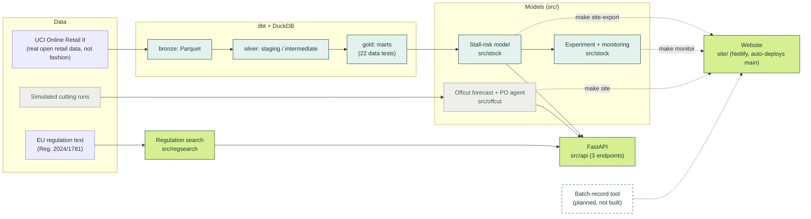

# Architecture

How the parts of this repository fit together, and the status of each one as of 21 Nov 2026.

Thread Futures is a service, not software: the product is selling brands' unsold stock and reporting where every item went. Until the go / pivot / stop decision on Fri 26 Feb 2027, nothing new is built and any early pilot runs by hand (spreadsheet and email). The code here is earlier, exploratory work.

Dotted arrows into `site/` are manual export steps. `site/` is the live website, so only run them on purpose and check `make site-diff` before committing.

## Status of each part

| Part | Where | Status | What that means |
|---|---|---|---|
| Website | `site/` | **Live** | Static HTML, published by Netlify when `main` changes. No build step. |
| Regulation search | `src/regsearch/` | **Live** (internal research aid) | Finds the article of EU law that answers a question. Rebuilds its index on each call, which is fine at this size. |
| API, CI and tests | `src/api/`, `tests/`, `.github/workflows/` | **Live** (maintenance only) | FastAPI with offcut, stall-risk and regulation-search endpoints; CI runs pytest, builds the Docker image and calls the API. |
| dbt pipeline | `dbt/` | **Maybe later** | Bronze → silver → gold on real open retail data, 22 data tests. Not run in CI. Could be reused for brands' stock files after pilots. |
| Stall-risk model, experiment, monitoring | `src/stock/` | **Maybe later** | ROC AUC 0.81 vs 0.60 for a simple rule, on retail data that is not fashion. A possible input to prevention ("make less"), a later stage. |
| Offcut forecast and purchase-order agent | `src/offcut/` | **Parked** | Earlier exploratory work for a previous idea (garment factories), not the product. Trained on simulated data. Kept as proof of build. |
| Batch-record tool | `docs/parts/18_batch_and_destination_file_prototype.md` | **Planned, not built** | The first piece of product software, if pilots show it is needed. Not before 26 Feb 2027; until then pilots run by hand. |

## Files that write into `site/`

| Command | Writes | Part of |
|---|---|---|
| `make monitor` | `site/reports/monitoring.html` | `make stock` |
| `make site` | `site/model.js` (offcut model) | `make all`, `make site-export` |
| `make site-export` | `site/model.js`, `site/data/stall_model.js`, `site/data/stock.js` | run on purpose only |

## Known gaps

- Locally, only the offcut tests run without the full environment (`fastapi` and `duckdb` are needed for the rest); CI has the full set.
- Several tests check saved artefacts in `models/` rather than re-running the code that made them.
- No tests yet for feature building, the experiment, training, monitoring, the site exports, ingest, the agent or generated regulation answers.
