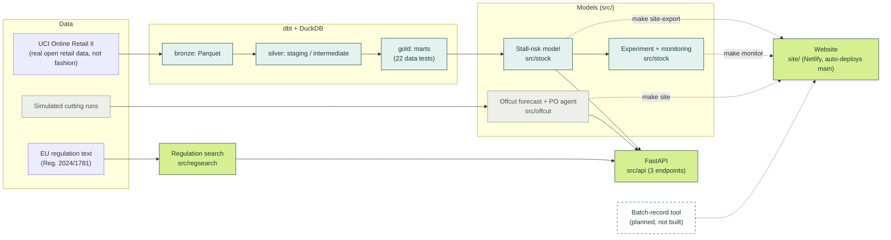

# Architecture

How the parts of this repository fit together, and the status of each one as of 21 Nov 2026.

Thread Futures is a service, not software: the product is selling brands' unsold stock and reporting where every item went. Until customer discovery concludes in early 2027, nothing new is built and any early pilot runs by hand (spreadsheet and email). The code here is earlier, exploratory work.

Dotted arrows into `site/` are manual export steps. `site/` is the live website, so only run them on purpose and check `make site-diff` before committing.

## Status of each part

| Part | Where | Status | What that means |
|---|---|---|---|
| Website | `site/` | **Live** | Static HTML, published by Netlify when `main` changes. No build step. |
| Regulation search | `src/regsearch/` | **Live** (internal research aid) | Finds the article of EU law that answers a question. Rebuilds its index on each call, which is fine at this size. |
| API, CI and tests | `src/api/`, `tests/`, `.github/workflows/` | **Live** (maintenance only) | FastAPI with offcut, stall-risk and regulation-search endpoints; CI runs pytest, builds the Docker image and calls the API. |
| dbt pipeline | `dbt/` | **Maybe later** | Bronze → silver → gold on real open retail data, 22 data tests. Not run in CI. Could be reused for brands' stock files after pilots. |
| Stall-risk model, experiment, monitoring | `src/stock/` | **Maybe later** | ROC AUC 0.81 vs 0.60 for a simple rule, on retail data that is not fashion. A possible input to prevention ("make less"), a later stage. |
| Offcut forecast and purchase-order agent | `src/offcut/` | **Parked** | Earlier exploratory work for a previous idea (garment factories), not the product. Trained on simulated data. Kept as proof of build. |
| Batch-record tool | [Part 18 in `docs/6_planned.md`](6_planned.md#part-18-batch-report-prototype) | **Planned, not built** | The first piece of product software, if pilots show it is needed. Not during customer discovery (to early 2027); until then pilots run by hand. |

## Files that write into `site/`

| Command | Writes | Part of |
|---|---|---|
| `make monitor` | `site/reports/monitoring.html` | `make stock` |
| `make site` | `site/model.js` (offcut model) | `make all`, `make site-export` |
| `make site-export` | `site/model.js`, `site/data/stall_model.js`, `site/data/stock.js` | run on purpose only |

## Known gaps

- Locally, only the offcut tests run without the full environment (`fastapi` and `duckdb` are needed for the rest); CI has the full set.
- Several tests check saved artefacts in `models/` rather than re-running the code that made them.
- No tests yet for feature building, the experiment, training, monitoring, the site exports, ingest, the agent or generated regulation answers.

## Documentation

The docs are grouped by theme. Each themed doc holds, for every part, a header block (discipline, methodology, tools, status), the short part note and the full step-by-step guide: the question it answers, the pipeline step by step with real code from this repo, every concept from scratch, the real results, what went wrong, honest limits, how to run it, and a glossary.

| Doc | Parts |
|---|---|
| [1_data_engineering.md](1_data_engineering.md) | 02 Analytics engineering, 03 Merchandising analytics |
| [2_ml_models.md](2_ml_models.md) | 01 Offcut forecasting, 04 Stall-risk model |
| [3_experiments_monitoring.md](3_experiments_monitoring.md) | 05 Experimentation and causal analysis, 06 Model monitoring |
| [4_ai_tools.md](4_ai_tools.md) | 07 Regulation search, 08 Purchase-order agent |
| [5_platform.md](5_platform.md) | 09 API service, 10 CI and Docker build |
| [6_planned.md](6_planned.md) | 11 to 18 (planned, not built) |

Parts 1 to 10 are built and public at https://github.com/catliugit/ThreadFutures: they are earlier, exploratory technical work, not the product (Thread Futures is a B2B resale service for fashion brands' unsold stock). Parts 11 to 18 are planned and not scheduled. Part 18, the batch report prototype, would be the first piece of product software (check, sell, donate or recycle only as a last resort, report); it is planned, not built, and nothing new is built during customer discovery (to early 2027), and any early pilot runs by hand (spreadsheet and email). The offcut forecast (Part 1) and the purchase-order agent (Part 8) are earlier exploratory work for a previous idea (garment factories), not the product.

Numbers come from the repo's models/*.json files; re-checked against them and dbt/target/run_results.json on 21 Nov 2026. Earlier check on 17 Nov 2026 (parts 7 to 10 against models/*.json, tests/ and the CI log of 17 Nov 2026: 23 tests passed).

## Discipline and methodology by part

Status follows the table above: **Live** (in use, maintenance only), **Maybe later** (could be reused after pilots), **Parked** (earlier exploratory work for a previous idea, garment factories, not the product), **Planned** (not built; Part 18 only after hand-run pilots).

| Part | Discipline (primary / secondary) | Methodology | Tools | Status | Data label | Doc |
|---|---|---|---|---|---|---|
| 01 Offcut forecasting | Machine Learning / Data Science | Simulated cutting runs (skyline-packed markers plus losses) → gradient-boosted quantile regression (P10/P50/P90) vs marker-only and 15% baselines; trees exported to JSON for the browser. | Python, scikit-learn, pandas, NumPy, Matplotlib, JavaScript | Parked | Simulated cutting runs (not factory data) | [2_ml_models.md](2_ml_models.md#part-01-offcut-forecasting) |
| 02 Analytics engineering (dbt + DuckDB) | Data Engineering / Data Analytics | Ingest to Parquet, then dbt on DuckDB: staging → SKU-week intermediate → star-schema marts, with generic, macro and reconciliation tests and a MetricFlow semantic layer. | dbt Core, DuckDB, SQL, Jinja, Parquet, MetricFlow, Python | Maybe later | Real open retail data | [1_data_engineering.md](1_data_engineering.md#part-02-analytics-engineering-dbt--duckdb) |
| 03 Merchandising analytics | Data Analytics / Data Engineering | SQL mart: dense weekly calendar, 8-week rolling velocity, ABC by cumulative revenue, XYZ by coefficient of variation, selling / slowing / stopped status. | SQL, dbt, Jinja, DuckDB | Maybe later | Real open retail data | [1_data_engineering.md](1_data_engineering.md#part-03-merchandising-analytics) |
| 04 Stall-risk model | Machine Learning / Data Science | Ten early-life features from DuckDB → gradient-boosting classifier with a time-based split, scored against a "sales halved" rule; tracked and registered in MLflow. | scikit-learn, MLflow, DuckDB, pandas, joblib, skops | Maybe later | Real open retail data | [2_ml_models.md](2_ml_models.md#part-04-stall-risk-model) |
| 05 Experimentation and causal analysis | Data Science / Data Analytics | Stacked difference-in-differences (OLS, stack fixed effects, SKU-clustered errors, matched cohort controls, placebo test); pilot power analysis, Welch's t-test and bootstrap CI. | statsmodels, SciPy, DuckDB, pandas, NumPy | Maybe later | Real data (markdowns) + simulated pilot | [3_experiments_monitoring.md](3_experiments_monitoring.md#part-05-experimentation-and-causal-analysis) |
| 06 Model monitoring | Machine Learning / Data Science | Per-quarter AUC, PR AUC and calibration; feature drift by PSI and KS test against alert thresholds; JSON plus static HTML report. | SciPy, scikit-learn, pandas, joblib, HTML | Maybe later | Real open retail data | [3_experiments_monitoring.md](3_experiments_monitoring.md#part-06-model-monitoring) |
| 07 Regulation search | AI Engineering / Data Science | Hand-written BM25 vs TF-IDF + cosine over chunked EU law, evaluated on 22 questions (hit@k, MRR); optional LLM answer with citation check. | Python, scikit-learn, NumPy, LLM API (optional) | Live | Retrieval prototype over real EU law text | [4_ai_tools.md](4_ai_tools.md#part-07-regulation-search) |
| 08 Purchase-order agent | AI Engineering / Machine Learning | LLM with one tool wrapping deterministic forecast, grading and recycler matching; assumptions flagged, bad inputs returned as tool errors. | Anthropic Python SDK (tool use), Python, pytest | Parked | Prototype (calls the simulated-data forecast; fictional recycler profiles) | [4_ai_tools.md](4_ai_tools.md#part-08-purchase-order-agent) |
| 09 API service | AI Engineering / Machine Learning | FastAPI with a health check and three versioned endpoints; Pydantic validation (422), cached model loading, TestClient tests. | FastAPI, Pydantic, uvicorn, joblib, pytest | Live | Prototype | [5_platform.md](5_platform.md#part-09-api-service) |
| 10 CI and Docker build | DevOps / Platform engineering / Machine Learning (MLOps) | GitHub Actions: pytest job, then a Docker build-and-run smoke test; slim, non-root image with HEALTHCHECK. | GitHub Actions, Docker, pytest, Make | Live | Infrastructure (built 9 Nov 2026) | [5_platform.md](5_platform.md#part-10-ci-and-docker-build) |
| 11 Stock health dashboard | Data Analytics / Data Engineering | Planned: BI star schema on the dbt marts with DAX measures that match the MetricFlow definitions. | Power BI, Looker Studio, DAX | Planned | Planned | [6_planned.md](6_planned.md#part-11-stock-health-dashboard) |
| 12 Customer analytics | Data Science / Data Analytics | Planned: SQL acquisition cohorts and retention, RFM with k-means, simple LTV (optionally BG/NBD). | SQL, dbt, Python, scikit-learn | Planned | Planned | [6_planned.md](6_planned.md#part-12-customer-analytics) |
| 13 Cloud warehouse | Data Engineering / Data Analytics | Planned: same dbt project on a BigQuery or Snowflake target; row counts compared with DuckDB. | BigQuery, Snowflake, dbt | Planned | Planned | [6_planned.md](6_planned.md#part-13-cloud-warehouse) |
| 14 Spark at scale | Data Engineering / Machine Learning | Planned: stall-risk feature table rebuilt in PySpark with window functions; Delta tables checked against DuckDB. | Databricks, PySpark, Delta Lake | Planned | Planned | [6_planned.md](6_planned.md#part-14-spark-at-scale) |
| 15 Seasonality fix | Machine Learning / Data Science | Planned: seasonal features plus Platt or isotonic calibration; monitoring re-run to measure the fix. | scikit-learn, pandas, SciPy | Planned | Planned | [6_planned.md](6_planned.md#part-15-seasonality-fix) |
| 16 Markdown pricing (Bayesian) | Data Science / Machine Learning | Planned: hierarchical Bayesian elasticity model with partial pooling by category (MCMC). | PyMC, ArviZ, pandas | Planned | Planned | [6_planned.md](6_planned.md#part-16-markdown-pricing-bayesian) |
| 17 Azure deploy | AI Engineering / Data Engineering | Planned: CI-built image pushed to a registry and deployed to Azure Container Apps. | Azure Container Apps, Azure Container Registry, Docker | Planned | Planned | [6_planned.md](6_planned.md#part-17-azure-deploy) |
| 18 Batch report prototype | Data Engineering / AI Engineering | Planned: batch / unit / handover data model, hash-chained append-only log, FastAPI export of the batch report and Article 24 rows. | SQL (SQLite/Postgres), FastAPI, pytest | Planned (after hand-run pilots) | Planned (not during customer discovery (to early 2027)) | [6_planned.md](6_planned.md#part-18-batch-report-prototype) |

## Concept index

Concept, then the part that explains it best (other parts that use it in brackets). Numbers are part numbers; find each part's doc in the table above. "11_to_17 (part 11)" means the step-by-step section of that planned part in [6_planned.md](6_planned.md).

Concept, then the file that explains it best (other files that use it in brackets).

#### Data and analytics engineering
| Concept | File |
|---|---|
| Medallion layout (bronze, silver, gold) | 02 (01) |
| Data contracts | 01 (02) |
| dbt models, materialisation, `ref()`, DAG | 02 |
| dbt sources and `var()` | 02 (planned 13) |
| dbt generic and singular tests, custom test macros | 02 (03) |
| Reconciliation test | 02 |
| Semantic layer, MetricFlow, entities, measures, metrics, time spine | 02 (planned 11) |
| Star schema, dimension and fact tables, grain | 02 |
| DuckDB | 02 |
| Parquet | 02 |
| Left-censoring | 02 (04) |
| Window functions, rolling averages, CTEs, Jinja | 03 |
| Dense vs sparse time series (zero weeks) | 03 (04) |
| `FILTER (WHERE ...)` aggregates | 04 |

#### Merchandising
| Concept | File |
|---|---|
| ABC classification, Pareto | 03 |
| XYZ classification | 03 |
| Coefficient of variation | 03 |
| Sales velocity, velocity ratio | 03 |
| Sell-through and weeks of cover (and why not used) | 03 |
| Markdown depth, list price as mode of small orders | 02, 03 |
| Return rate | 03 (02) |
| Launch cohorts | 03 (05) |

#### Machine learning
| Concept | File |
|---|---|
| Simulation from first principles | 01 |
| Quantile regression, pinball loss | 01 |
| P10 / P50 / P90, interval coverage, quantile crossing | 01 |
| Gradient boosting (regression and classification), trees, hyperparameters | 01, 04 |
| One-hot encoding | 01 |
| Train/test split vs time-based split | 01, 04 |
| Data leakage, censoring leakage | 01, 04 |
| Baselines | 01, 04 |
| MAE, MAPE, within ±15%, bias | 01 |
| Base rate | 04 |
| ROC AUC vs PR AUC | 04 (06) |
| Precision at top k | 04 |
| Calibration, Brier score | 04, 06 (planned 15) |
| Feature importance | 04 |
| MLflow tracking and model registry, joblib, skops | 04 |
| Float32 thresholds, export parity tests | 01 (04, 09) |

#### Experimentation and causal inference
| Concept | File |
|---|---|
| Correlation vs causation, observational vs randomised | 05 |
| Difference-in-differences, stacked DiD | 05 |
| Parallel trends, placebo test, pre-trend, upper bound | 05 |
| Matched controls, fixed effects | 05 |
| Clustered standard errors | 05 |
| Log outcomes as percentage effects | 05 |
| Confidence intervals, p-values | 05 |
| Power analysis, effect size (Cohen's d), alpha, power | 05 |
| Welch t-test | 05 |
| Bootstrap confidence interval | 05 |

#### Monitoring
| Concept | File |
|---|---|
| Data drift vs concept drift | 06 |
| PSI (Population Stability Index) | 06 |
| KS test | 06 |
| Ranking vs calibration by period | 06 |
| Alert thresholds, alert fatigue | 06 |
| Static HTML reports | 06 |

#### Search and language models
| Concept | File |
|---|---|
| Tokenisation, stop words, stemming | 07 |
| TF-IDF, cosine similarity | 07 |
| BM25 (k1, b) | 07 |
| hit@k, MRR, evaluation sets | 07 |
| Retrieval-augmented generation (RAG), hallucination | 07 |
| Citation checking | 07 |
| Embeddings, hybrid search (not yet used) | 07 |
| Tool use / function calling, agents, agent loop | 08 |
| System prompts, structured extraction, flagged assumptions | 08 |
| Tool errors as feedback | 08 |
| Hard constraints then weighted scoring (recycler matching) | 08 |
| Environment variables, `.env` and secrets | 08 (10) |

#### Software and deployment
| Concept | File |
|---|---|
| REST, HTTP methods, status codes (422) | 09 |
| FastAPI, Pydantic validation, `Literal`, `Field` | 09 |
| Health checks, versioned endpoints | 09 (10) |
| pytest, TestClient, unit vs integration tests | 09 |
| CI, GitHub Actions (workflow, job, step, runner, `needs`) | 10 |
| Pinned dependencies | 10 |
| Docker image vs container, Dockerfile layers, non-root user, HEALTHCHECK | 10 |
| Smoke tests | 10 |
| Container registry, CD | 10 (planned 17) |

#### Planned (not built)
| Concept | File |
|---|---|
| DAX, filter context, BI data models | 11_to_17 (part 11) |
| Cohort retention, churn, RFM, k-means, LTV, BG/NBD | 11_to_17 (part 12) |
| Cloud warehouses, dbt targets and adapters, SQL dialects | 11_to_17 (part 13) |
| Spark, lazy evaluation, shuffles, Delta Lake | 11_to_17 (part 14) |
| Seasonal features, Platt scaling, isotonic regression, reliability diagrams | 11_to_17 (part 15) |
| Elasticity, Bayesian inference, partial pooling, MCMC, credible intervals | 11_to_17 (part 16) |
| Azure Container Apps, ingress, scale to zero, revisions | 11_to_17 (part 17) |
